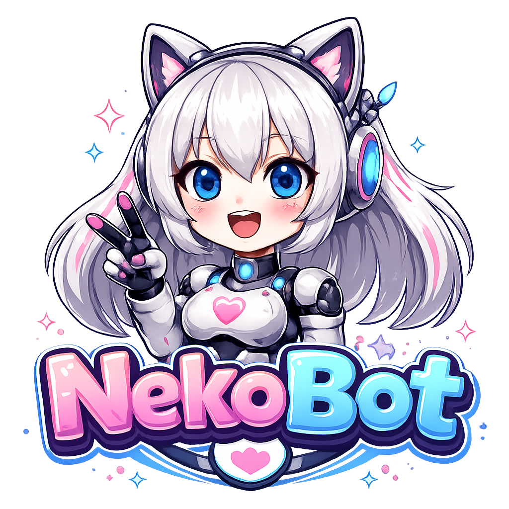

# NekoBot


[](LICENSE)


<p align="center">
  
</p>


A prefix-based Discord bot written in TypeScript (discord.js v14) with music playback, moderation tools and multi-language support (English and Indonesian included). All replies are embeds.

## Commands

Default prefix is `!` (change it per server with `!prefix set <new>`).

**General**
- [+] `help` (`h`, `commands`): list all commands, or `!help <command>` for details
- [+] `ping`: bot latency
- [+] `botinfo` (`about`, `stats`): version, servers, commands, uptime, library and Node.js version
- [+] `invite` (`inv`): link to add the bot to another server, with the permissions it needs
- [+] `serverinfo` (`server`, `guildinfo`): owner, creation date, members, channels, roles and boosts

**Config**

Anyone can look at a setting; changing it needs Manage Server.
- [+] `settings` (`config`, `cfg`): all settings of this server at a glance
- [+] `prefix`: show the prefix, or `!prefix set <new>` to change it (up to 5 characters)
- [+] `language` (`lang`): show or change the bot language
- [+] `247` (`stay`, `24/7`) `[on|off]`: stay in the voice channel even when nothing is playing
- [+] `idletime` (`idle`) `[minutes|reset]`: how long the bot waits before leaving an idle voice channel (1 to 60 minutes)

**Music**
- [+] `play` (`p`): song name, video URL or playlist URL
- [+] `random` (`rand`, `rnd`) `[genre or artist]`: play a random song
- [+] `pause`, `resume` (`unpause`), `skip` (`s`, `next`), `stop`
- [+] `queue` (`q`), `nowplaying` (`np`)
- [+] `loop [off|track|queue]` (`repeat`), `shuffle` (`mix`), `remove <n>` (`rm`)
- [+] `join` (`j`), `leave` (`l`, `disconnect`, `dc`)

**Moderation**

Each command needs the Discord permission shown in brackets. The server owner and Administrators can use all of them.
- [+] `kick <@user|ID> [reason]` (Kick Members)
- [+] `ban <@user|ID> [reason]` (Ban Members): also works with the ID of someone who already left
- [+] `unban <ID> [reason]` (`pardon`) (Ban Members)
- [+] `mute <@user|ID> [duration] [reason]` (`timeout`) (Moderate Members): a Discord timeout. Duration is a number and a unit (`30s`, `10m`, `2h`, `1d`, `1w`), up to 28 days, `10m` if left out
- [+] `unmute <@user|ID> [reason]` (`untimeout`) (Moderate Members)
- [+] `warn <@user|ID> [reason]`, `warnings <@user|ID>` (`warns`), `unwarn <@user|ID> <number|all>` (`delwarn`) (Moderate Members)
- [+] `clear <1-100> [@user|ID]` (`purge`, `prune`) (Manage Messages): deletes the latest messages, optionally only those of one user. Pinned messages and messages older than 14 days are skipped

You cannot act on yourself, the bot, the server owner, or someone whose highest role is the same as or above yours (the owner is exempt from that last rule). The bot's own role must also be above the target's. Kick, ban, mute and warn send the member a DM with the reason when their DMs are open, and kick, ban and mute put the reason in the server's audit log.

Playlists and YouTube mixes: `!play <playlist link>` queues up to 50 songs (change with `MAX_PLAYLIST`).
A link that has both a video and a list (`watch?v=...&list=...`) plays only the video; add `--playlist` to load the whole list. 
This includes the `&list=RD...&start_radio=1` that YouTube adds to many copied links: they play a single video, and a mix is loaded only with `--playlist`.

`!random` picks a song from a built-in list of keywords (edit `KEYWORDS` in `src/commands/Voices/random.ts`), or from your own search: `!random lofi`, `!random Bondan Prakoso`. 
It only picks songs between 1 and 10 minutes long and skips songs that are already in the queue.

## Setup

Requirements: 
- Node.js 22.12 or newer (developed on v24)
- [yt-dlp](https://github.com/yt-dlp/yt-dlp) for music (ffmpeg is bundled through `ffmpeg-static`)

```bash
npm install
```

**1. Discord Developer Portal**

- Bot tab → Privileged Gateway Intents: enable **Message Content Intent** and **Server Members Intent**.
- Installation tab → Default Install Settings → Guild Install: add the `bot` scope and these permissions:
  View Channels, Send Messages, Embed Links, Read Message History, Connect, Speak, Manage Messages, Kick Members, Ban Members and Moderate Members.
  (Once the bot is in a server, `!invite` gives a link with the same permissions.)
- For the moderation commands, move the bot's role above the members you want to moderate (Server Settings → Roles).

**2. Create a `.env` file**

```env
DISCORD_TOKEN=your-bot-token
PREFIX=!
OWNER_ID=your-user-id

# Optional
# IDLE_LEAVE_MINUTES=3
# YTDLP_PATH=D:\path\to\NekoBot\lib\yt-dlp.exe
# MAX_PLAYLIST=50
# LOG_LEVEL=info
```

`IDLE_LEAVE_MINUTES` is the default for every server; each server can change its own with `!idletime`.

**3. yt-dlp**

Put `yt-dlp.exe` in the `lib/` folder (it is ignored by Git) and set `YTDLP_PATH` to it, or make sure `yt-dlp` is on your PATH.
Keep yt-dlp updated (`yt-dlp -U`), since YouTube changes often.

YouTube also needs a JavaScript runtime. Download `deno.exe` from the
[Deno releases](https://github.com/denoland/deno/releases) into `lib/` and create
`lib/yt-dlp.conf` containing:

    --js-runtimes deno:D:/path/to/NekoBot/lib/deno.exe

Check it with `yt-dlp -v -s <video url>`: the log should show `JS runtimes: deno-x.y.z`.

## Run

```bash
npm run dev     # development (tsx, watch mode)
npm run build   # compile to dist/
npm start       # run the compiled bot (run build first)
```

Notes:
- In watch mode, new command files and edits to the files in `locales/` need a manual restart.
- Per-server data (prefix, language, settings, warnings) is saved as JSON in `data/`. The folder is created automatically, is ignored by Git, and is shared by dev mode and `npm start`. If one of these files ever becomes unreadable, the bot keeps a copy next to it as `<name>.json.corrupt-<time>` and starts empty instead of overwriting it.
- The bot leaves the voice channel 3 minutes after the queue ends (`IDLE_LEAVE_MINUTES`, or per server with `!idletime`). With `!247 on` it stays instead. 24/7 mode is not remembered across a restart: the bot does not rejoin a voice channel on its own.
- When the bot joins a new server it posts a short welcome message in the system channel, or in the first channel it can write in.
- Logging: `npm run dev` prints everything (loaded commands, every command that runs, warnings and errors). `npm start` prints only start-up, warnings and errors, at most 30 lines per minute. Change it with `LOG_LEVEL=debug|info|warn|error|silent` in `.env`.

## Project structure

```
locales/         # translations: en.json, id.json, ...
data/            # per-server data, created at runtime (ignored by Git)
src/
├── commands/    # one file per command, grouped into category folders
│   ├── General/
│   ├── Config/
│   ├── Voices/
│   └── Moderation/
├── events/      # Discord event handlers (messageCreate, clientReady, guildCreate)
├── handlers/    # loaders for commands and events
├── music/       # queue, yt-dlp source, voice checks
└── utils/       # locale loader, embed helpers, logger, server settings, moderation helpers, paths
```


## Adding a command

Create `src/commands/<Category>/<name>.ts` that exports an object. It is loaded automatically (restart in watch mode):

```ts
import { Client, Message } from 'discord.js';
import { t } from '../../utils/locale';
import { say } from '../../utils/embedBuilder';

export default {
    name: 'Hello',
    description: 'Says hello.',
    usage: ['!hello'],
    aliases: ['hi'],
    category: 'General',
    examples: ['!hello'],
    // permissions: PermissionFlagsBits.KickMembers,   // optional: who may use it

    async execute(message: Message, args: string[], client: Client) {
        if (!message.guild) return;
        return say(message, t(message.guild.id, 'hello.text'));
    },
};
```

Then add the texts to every file in `locales/`: `commands.hello.description` (shown by `!help`) and any keys the command uses, such as `hello.text` above. `category` decides where the command is listed in `!help`; keep it the same as the folder's name. A new category also needs an entry in `CATEGORY_ORDER` in `src/commands/General/help.ts` and in `help.categories` in the locale files.

## Adding a language

Copy `locales/en.json` to `locales/<code>.json` (for example `ja.json`) and translate the values.
Keep the keys and placeholders such as `{title}` unchanged. Restart the bot and the language
shows up in `!language`. Missing keys fall back to English.

## License

[MIT](LICENSE)
